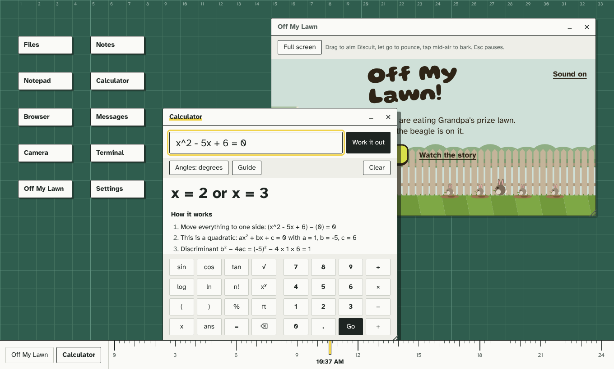

# PyOS

A small desktop environment written in Python. Run one file, and a desktop opens in your
browser with a file manager, notes, chat, a camera, a terminal and settings. Everything you
make is saved on your computer.



## Run it

You need Python 3.12 or newer. There is nothing to install.

```sh
python Projectos.py
```

Your browser opens at <http://localhost:8080>. Press Ctrl+C in the terminal to stop it.

| Option | What it does |
| --- | --- |
| `--port 9000` | Use a different port |
| `--data-dir ./my-data` | Keep files somewhere other than `~/.pyos` |
| `--host 0.0.0.0` | Let others on your network open PyOS and chat with you in Messages |
| `--no-browser` | Don't open a browser window |

With Docker: `docker compose -f .build/docker-compose.yml up`

## Put it online

**Vercel.** Import the repository and deploy with the default settings. `vercel.json` already
sends every request to the Python function in `api/index.py`, which serves both the desktop
and the API. Vercel runs Python as
short-lived functions with a temporary disk, so on Vercel:

- files, notes and settings reset whenever the function restarts (often within minutes),
- Messages only reach people whose requests land on the same running copy,
- uploads are capped at about 4.5 MB.

That's fine for showing PyOS off. To keep data, run the Docker image on a host with a
persistent disk (Render, Railway, Fly.io or your own server) and mount a volume at `/data`.

PyOS has no login. Anyone with the link can read, change and delete what's in it, so don't put
anything private on a public deployment.

## What's on the desktop

- **Files** opens your home folder. Double-click to open folders, text files (in an editor)
  and images. Upload with the button or by dragging files in. Select an item to download,
  rename or delete it.
- **Notes** saves as you type. Use "Save to Documents" to keep a note as a text file.
- **Messages** is a chat with channels. Everyone using the same PyOS server sees the same
  messages, so run it with `--host 0.0.0.0` to chat across your network.
- **Camera** takes photos and saves them to Pictures. Your browser asks for permission first.
- **Terminal** works inside your home folder. Type `help` for the commands, and try
  `calc sqrt(2) * 10`.
- **Settings** changes your name, the mat color, light or dark windows, and grid snapping.

Drag windows by their title bar and resize them from the bottom-right corner. When you drop a
window, it snaps to the grid. The ruler along the bottom is the clock: the yellow mark moves
across the day from 0 to 24.

## Project layout

```
.github/          CI workflows, issue and pull request templates
.build/           Dockerfile and docker-compose.yml
.config/          example environment settings
assets/           screenshot and images for the docs
docs/             architecture and API reference
src/backend/pyos  Python server, storage and terminal
src/frontend      the desktop UI (HTML, CSS, JavaScript; no build step)
test/             unit and API tests
api/index.py      Vercel entry point
vercel.json       Vercel settings
Projectos.py      launcher
```

Read [docs/architecture.md](docs/architecture.md) for how it fits together and
[docs/api.md](docs/api.md) for the HTTP API.

## Develop

```sh
python -m unittest discover -s test
```

See [CONTRIBUTING.md](CONTRIBUTING.md). Report security problems as described in
[SECURITY.md](SECURITY.md).

## License

[MIT](LICENSE)
